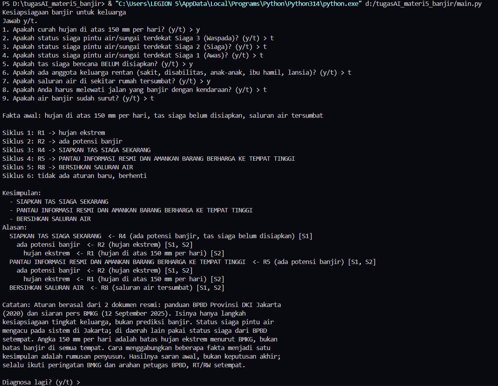
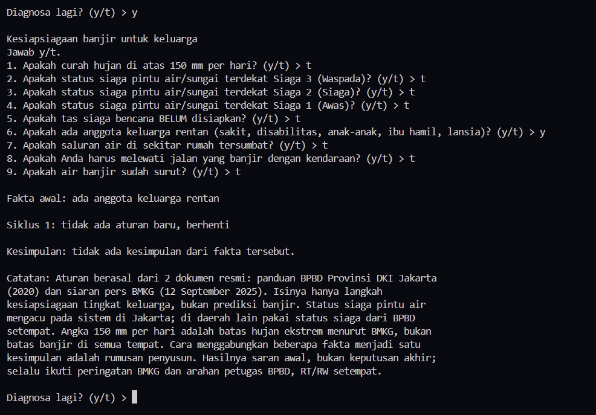
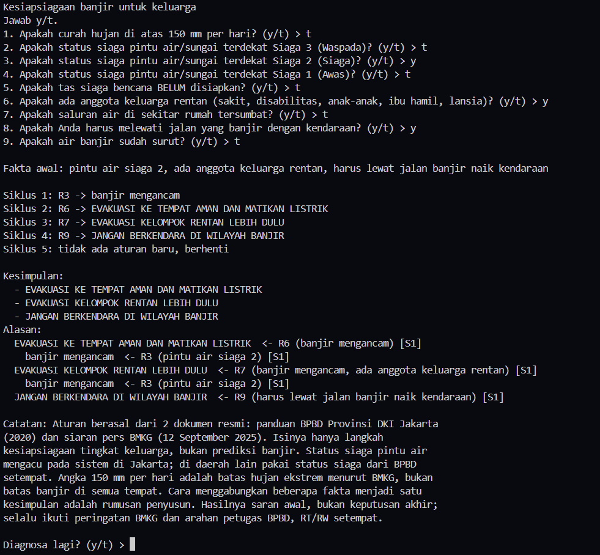

# Tugas 5 - Sistem Pakar Sederhana: Kesiapsiagaan Banjir

- **Nama:** Nadin Mufida
- **NIM:** F1D02410128
- **Mata kuliah:** Kecerdasan Buatan

## 1. Topik dan cara menjalankan

Topik: **kesiapsiagaan banjir untuk keluarga** (bukan kesehatan manusia). Program bertanya kondisi hujan, status siaga sungai, dan keluarga, lalu menyimpulkan langkah yang perlu dilakukan beserta alasannya.

- Bahasa: Python 3.14 (versi 3.8 ke atas cukup), tanpa library tambahan.
- Mesin forward chaining ditulis sendiri di `main.py`. Aturan ada di `kb_banjir.json`.

Jalankan dari dalam folder ini:

```bash
python main.py   # jalankan program
python test.py   # uji otomatis 5 kasus
```

Di Windows, jika `python` tidak dikenali, coba `py main.py`.

**Cara mengisi jawaban:** program menampilkan pertanyaan bernomor, misalnya `1. Apakah curah hujan di atas 150 mm per hari? (y/t) >`. Ketik `y` untuk ya atau `t` untuk tidak, lalu tekan Enter. Setelah semua pertanyaan dijawab, program menampilkan siklus, kesimpulan, alasan, dan catatan batas keberlakuan. Di akhir, program bertanya `Diagnosa lagi? (y/t)`; ketik `y` untuk mengulang dengan jawaban baru atau `t` untuk selesai.

File: `kb_banjir.json` (aturan dan sumber), `main.py` (program), `test.py` (uji), `hasil/` (keluaran teks), `screenshot/` (tangkapan layar).

## 2. Sumber

| Kode | Judul | Penerbit | Tahun | URL | Diakses |
|---|---|---|---|---|---|
| S1 | Panduan Kesiapsiagaan Menghadapi Banjir bagi Masyarakat (buku saku; hlm. 8-9, 23-26) | BPBD Provinsi DKI Jakarta | 2020 (kata pengantar September 2020, Cetakan Pertama Oktober 2020) | https://ppid.jakarta.go.id/assets/pdf/buku-saku-panduan-kesiapsiagaan-menghadapi-banjir-bagi-masyarakat.pdf | 11 Nov 2026 |
| S2 | Cuaca Ekstrem Masih Mengintai, BMKG Ingatkan Kesiapsiagaan Nasional (siaran pers) | BMKG | 12 September 2025 | https://www.bmkg.go.id/siaran-pers/cuaca-ekstrem-masih-mengintai-bmkg-ingatkan-kesiapsiagaan-nasional | 11 Nov 2026 |

Aturan adalah parafrasa, bukan kutipan. Isi yang diambil dari sumber:
- S1 hlm. 8-9: status siaga pintu air (Siaga 4 Normal, Siaga 3 Waspada, Siaga 2 Siaga, Siaga 1 Awas); peringatan SMS dikirim ke warga bantaran sungai saat siaga II dan I.
- S1 hlm. 23: isi tas siaga bencana (pakaian 3 hari, obat, dokumen, makanan tahan lama, air minum, senter, dan lain-lain).
- S1 hlm. 24: jangan abaikan saluran air yang tersumbat; jika sudah ada potensi banjir, perhatikan informasi peringatan dini, amankan barang berharga ke tempat tinggi, matikan listrik dan siapkan tas siaga, ikuti arahan petugas.
- S1 hlm. 25: saat banjir, evakuasi ke tempat aman dan prioritaskan kelompok rentan (orang sakit, disabilitas, anak-anak, ibu hamil, lansia); jangan mengemudikan mobil di dan ke arah wilayah banjir.
- S1 hlm. 26: setelah banjir, kembali ke rumah setelah aman, waspada instalasi listrik, binatang berbisa, dan area longsor/ambles.
- S2: hujan di atas 150 mm per hari termasuk kategori ekstrem; sedimentasi dan sampah yang menyumbat saluran air memperparah genangan; masyarakat diminta mengikuti informasi resmi BMKG.

Yang merupakan rumusan saya sendiri: menganggap hujan ekstrem atau status Siaga 3 sebagai "ada potensi banjir", dan menganggap Siaga 2 atau Siaga 1 sebagai "banjir mengancam".

## 3. Tabel aturan (10 aturan, 7 kesimpulan akhir)

Hasil antara (miring) dipakai aturan lain. Kesimpulan akhir ditulis tebal.

| Aturan | IF | THEN | Sumber |
|---|---|---|---|
| R1 | hujan di atas 150 mm per hari | *hujan ekstrem* | S2 |
| R2 | *hujan ekstrem* ATAU pintu air siaga 3 | *ada potensi banjir* | S1, S2 |
| R3 | pintu air siaga 2 ATAU pintu air siaga 1 | *banjir mengancam* | S1 |
| R4 | *ada potensi banjir* DAN tas siaga belum disiapkan | **SIAPKAN TAS SIAGA SEKARANG** | S1 |
| R5 | *ada potensi banjir* | **PANTAU INFORMASI RESMI DAN AMANKAN BARANG BERHARGA KE TEMPAT TINGGI** | S1, S2 |
| R6 | *banjir mengancam* | **EVAKUASI KE TEMPAT AMAN DAN MATIKAN LISTRIK** | S1 |
| R7 | *banjir mengancam* DAN ada anggota keluarga rentan | **EVAKUASI KELOMPOK RENTAN LEBIH DULU** | S1 |
| R8 | saluran air tersumbat | **BERSIHKAN SALURAN AIR** | S1, S2 |
| R9 | harus lewat jalan banjir naik kendaraan | **JANGAN BERKENDARA DI WILAYAH BANJIR** | S1 |
| R10 | air banjir sudah surut | **WASPADA SETELAH BANJIR: LISTRIK, BINATANG BERBISA, JALAN AMBLES** | S1 |

Rantai aturan: R1 -> R2 -> R4 dan R5 (hasil R1 dipakai R2, hasil R2 dipakai R4 dan R5). Fakta yang ditanyakan ke user adalah fakta yang tidak pernah menjadi hasil aturan (9 pertanyaan).

## 4. Metode: Forward Chaining

Dipilih karena user sudah tahu faktanya (hujan, status siaga, kondisi keluarga), dan kesimpulan muncul dari rantai aturan. Langkahnya:

```
memori <- fakta yang dijawab "ya"
ULANGI:
    cocok <- aturan yang syaratnya terpenuhi DAN hasilnya belum ada di memori
    JIKA cocok kosong: BERHENTI
    r <- aturan pertama di cocok
    tambahkan r.maka ke memori dan catat bahwa r.maka berasal dari r
```

Mode `dan` = semua syarat harus ada di memori. Mode `atau` = cukup satu syarat. Aturan yang hasilnya sudah ada tidak dijalankan lagi supaya program berhenti. Alasan ditampilkan dengan menelusuri balik dari kesimpulan ke aturan yang menghasilkannya, sampai ke jawaban user.

## 5. Kasus uji

| # | Jawaban "ya" | Kesimpulan | Keluaran |
|---|---|---|---|
| 1 | hujan di atas 150 mm, tas siaga belum disiapkan, saluran tersumbat | siapkan tas siaga; pantau informasi dan amankan barang; bersihkan saluran air | `hasil/kasus1.txt` |
| 2 (negatif) | ada anggota keluarga rentan saja | tidak ada | `hasil/kasus2.txt` |
| 3 | pintu air siaga 2, ada anggota rentan, harus lewat jalan banjir naik kendaraan | evakuasi dan matikan listrik; evakuasi kelompok rentan lebih dulu; jangan berkendara | `hasil/kasus3.txt` |

`test.py` juga menguji 2 kasus lain (siaga 3 saja; air sudah surut). Kasus 2 tidak menghasilkan kesimpulan karena anggota rentan baru relevan kalau banjir mengancam (R7 butuh R3).





## 6. Batas keberlakuan

Pengetahuan dalam program ini berasal dari dua dokumen resmi: panduan BPBD Provinsi DKI Jakarta (2020) dan siaran pers BMKG (12 September 2025). Aturannya hanya untuk langkah kesiapsiagaan tingkat keluarga, bukan untuk memprediksi banjir. Status siaga pintu air mengacu pada sistem di Jakarta; di daerah lain gunakan status siaga dari BPBD setempat. Angka 150 mm per hari adalah batas hujan ekstrem menurut BMKG, bukan batas banjir di semua tempat. Hasilnya adalah saran awal, bukan keputusan akhir; selalu ikuti peringatan BMKG dan arahan petugas BPBD serta RT/RW setempat. Catatan ini juga ditampilkan di akhir keluaran program.

## 7. Penggunaan alat bantu AI

Saya menggunakan Claude (AI) sebagai alat bantu untuk menyusun draf aturan dari sumber dan menulis kode awal program. Aturan dan kode tersebut saya periksa sendiri, dan saya memahami cara kerjanya.